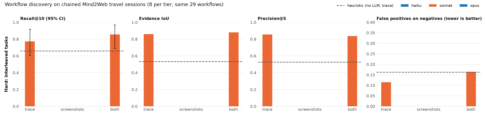

# Replicate: finding automatable workflows in browser sessions

*Benchmark, baselines and results. 2026-10-09.*

## 1. Problem

People repeat procedures in the browser all day: check a flight's status, re-run
the same hotel search with new dates, look up a booking by reference number.
**Replicate** is the feature that watches those sessions and says *"you did this
four times this week, here is an automation for it, with these parameters"*.

This work is about the **discovery** step, not execution. Given a recording of
browser activity, a system must:

1. find the procedures that were performed **two or more times with different inputs**,
2. ignore one-off tasks and unrelated browsing,
3. point at the **evidence** (when each occurrence happened), and
4. describe the procedure well enough to build an automation from it (steps + parameters).

To measure this you need long, realistic sessions with known answers. No such
public dataset exists, so this repo builds one from an existing dataset and
evaluates Claude models on it.

## 2. Benchmark design

### Data: chained Mind2Web tasks

[Multimodal-Mind2Web](https://huggingface.co/datasets/osunlp/Multimodal-Mind2Web)
(CC BY 4.0) has 2,022 human demonstrations of short web tasks on 100+ real sites,
with a screenshot, a DOM snapshot and the target element for every action. 598 of
them are travel tasks (airlines, hotels, car rental, ground transport, restaurants).

Sessions are built by **chaining** these tasks:

- **Workflow templates.** Travel tasks are grouped per site into templates, such as
  "check AA flight status by flight number and date". Each group is a procedure a
  single parameterised automation could replay. Sonnet does the grouping from
  the task text and action sequence (structured output, one call per site), and
  then a structural filter keeps only instances whose action skeleton (op + element
  role sequence) is at least 50% similar to the template's medoid. Result: 294
  templates, 128 with ≥2 instances.
- **Sessions.** Each session draws 3-5 templates, with 2-6 instances each
  (workflows), 3-5 travel one-offs (half on the *same sites* as the workflows, as
  hard negatives), and 2-4 distractors from shopping and entertainment. It
  interleaves them so that instances of the same workflow are not adjacent, and
  splits 1-2 instances with an interruption. No task is used twice.
- **Ground truth by construction.** Each repeated template in a session is one
  opportunity, its instances' actions are the evidence, and everything else is a
  negative. No hand labelling.
- **Timing is synthetic.** Mind2Web has no timestamps. Action durations, reading
  pauses and occasional 3-12 minute breaks are sampled, and the manifest marks
  timing as `synthetic`.

### Two tiers, same tasks

Each seed produces the same task selection twice, so the two tiers differ only
in how the user works:

- **Easy** (`s001`-`s008`): one task at a time, with a pause between tasks, and
  1-2 instances interrupted once. Pauses give task boundaries away.
- **Hard** (`h001`-`h008`): the user multitasks. 2-3 tasks are open at once, like
  browser tabs, and the user switches between them mid-task (it stays on the
  same task about 60% of the time). Each one-off on a workflow's site is opened
  right next to an instance of that workflow. Pauses come from one distribution
  whether or not the user switched tasks, and breaks can land mid-task, so
  timing carries no boundary signal (a test pins this). 52 of the 71 workflow
  instances are split, into up to 8 pieces. The prompt tells models the user
  multitasks and asks for each occurrence as a list of segments. The scorer then
  counts every action a prediction covers, including actions of other tasks
  inside an instance.

| | |
|---|---|
| Sessions | 8 per tier (easy 18-50 min, hard 7-38 min; 75-204 actions, 1,029 actions per tier) |
| Task segments | easy 134 (one per task, plus interruptions), hard 318 |
| Workflows (ground-truth opportunities) | 29 across 20 sites, 71 instances (22 workflows × 2, 3 × 3, 3 × 4, 1 × 6) |
| Split instances | easy 10, hard 52 (up to 8 pieces) |
| Negatives | 31 travel one-offs (24 on a workflow's own site) + 22 distractors |
| Inputs per action | 1280×800 viewport screenshot, cleaned DOM snapshot, target element (role, text, bbox), typed value |

### Input: browser signals only

The bundle format (`data/schemas/manifest.schema.json`, v0.2) is browser-only: the
macOS fields of v0.1 (displays, host, video) are now optional, and
`traces/dom.jsonl` plus screenshots are the core streams. That is what the Chrome
extension captures, so real recordings can go through the same harness later.
Task text never reaches a model. Models see only what a recorder would see.

Three input conditions:

- **trace**: one line per action: time, site, op, element role/text, typed value.
- **screenshots**: contact sheets of the viewport before each action (6 per
  sheet, captioned with *t*), with the acted-on element boxed in red as a
  stand-in for a visible cursor. No text trace.
- **both**: trace + sheets.

### Metrics

Scoring works at the **action level** (`evaluation/replicate/score.py`). A predicted
instance `[start_t, end_t]` covers the actions inside it (±3 s). A true instance
is its set of actions. In the easy tier, other tasks' actions inside an
interrupted instance are *don't-care*, so a model may report an interrupted
instance either as one span or as its pieces. In the hard tier they count, so
lumping an interleaved stretch into one span is penalised. Predictions are matched to ground truth greedily in rank order
at evidence IoU ≥ 0.3.

| Metric | Meaning |
|---|---|
| P@5 | matched predictions in the top 5 / min(5, #predictions) |
| R@10 | ground-truth workflows matched by the top 10 |
| Evidence IoU | action-level IoU of matched pairs |
| Instance F1 | per matched pair, predicted vs true occurrences (IoU ≥ 0.5) |
| FP on negatives | unmatched predictions whose evidence is mostly one-off/distractor actions |
| Time recall | share of workflow time found (synthetic timing, indicative only) |
| Reconstruction, feasibility | LLM judge, 1-5, on matched pairs: is it the same procedure with the right steps and parameters? could you build an automation from the spec? |

Sonnet is the judge. Opus re-judges a deterministic 1-in-5 sample to give an
agreement figure, and `data/results/judge_agreement_sample.csv` holds 25 items with
blank columns for a human pass.

### Baselines

- **heuristic** (no LLM): split the trace at pauses over 12 s or site changes, then
  cluster episodes within a site by action-skeleton similarity, and rank clusters
  by time spent.
- **Claude Haiku, Sonnet, Opus** via `claude -p` with schema-validated structured
  output, one call per session, crossed with the three input conditions.

## 3. Results



**Easy tier** (one task at a time)

| model | input | P@5 | R@10 | R@10 95% CI | evidence IoU | inst F1 | FP neg | time rec* | recon | feas |
|---|---|---|---|---|---|---|---|---|---|---|
| heuristic | trace | 0.84 | 0.80 | 0.64-0.96 | 0.90 | 0.91 | 0.08 | 0.81 | 3.50 | 2.12 |
| haiku | trace | 0.97 | 0.97 | 0.91-1.00 | 0.97 | 0.98 | 0.05 | 0.99 | 4.36 | 3.89 |
| haiku | screenshots | 0.93 | 0.96 | 0.88-1.00 | 0.94 | 0.96 | 0.09 | 0.97 | 4.04 | 3.75 |
| haiku | both | 0.97 | 0.97 | 0.91-1.00 | 0.95 | 0.96 | 0.02 | 0.99 | 4.57 | 3.96 |
| sonnet | trace | 0.94 | 0.93 | 0.83-1.00 | 0.98 | 0.98 | 0.07 | 0.96 | 4.26 | 3.63 |
| sonnet | screenshots | 0.82 | 0.96 | 0.88-1.00 | 0.95 | 0.96 | 0.23 | 0.97 | 4.00 | 3.64 |
| sonnet | both | 0.87 | 1.00 | 1.00-1.00 | 0.96 | 0.95 | 0.13 | 1.00 | 4.31 | 3.79 |
| opus | trace | 0.97 | 1.00 | 1.00-1.00 | 0.99 | 1.00 | 0.02 | 1.00 | 4.38 | 3.90 |
| opus | screenshots | 0.97 | 1.00 | 1.00-1.00 | 0.99 | 0.99 | 0.02 | 1.00 | 4.21 | 3.90 |
| opus | both | 1.00 | 1.00 | 1.00-1.00 | 1.00 | 1.00 | 0.02 | 1.00 | 4.38 | 4.00 |

**Hard tier** (interleaved tasks, same 29 workflows)

| model | input | P@5 | R@10 | R@10 95% CI | evidence IoU | inst F1 | FP neg | time rec* | recon | feas |
|---|---|---|---|---|---|---|---|---|---|---|
| heuristic | trace | 0.63 | 0.69 | 0.56-0.81 | 0.62 | 0.66 | 0.21 | 0.67 | 2.90 | 1.75 |
| haiku | trace | 0.80 | 0.89 | 0.72-1.00 | 0.82 | 0.80 | 0.20 | 0.88 | 4.15 | 3.77 |
| haiku | screenshots | 0.76 | 0.86 | 0.76-0.96 | 0.79 | 0.85 | 0.22 | 0.87 | 4.04 | 3.88 |
| haiku | both | 0.85 | 0.96 | 0.88-1.00 | 0.87 | 0.94 | 0.14 | 0.97 | 4.32 | 4.00 |
| sonnet | trace | 0.90 | 0.90 | 0.80-0.97 | 0.83 | 0.85 | 0.10 | 0.91 | 4.04 | 3.42 |
| sonnet | screenshots | 0.67 | 0.87 | 0.77-0.96 | 0.82 | 0.91 | 0.29 | 0.90 | 3.92 | 3.40 |
| sonnet | both | 0.73 | 0.93 | 0.83-1.00 | 0.90 | 0.92 | 0.20 | 0.92 | 4.19 | 3.63 |
| opus | trace | 1.00 | 0.96 | 0.88-1.00 | 0.93 | 0.91 | 0.02 | 0.97 | 4.25 | 3.86 |
| opus | screenshots | 1.00 | 0.96 | 0.88-1.00 | 0.96 | 0.99 | 0.00 | 0.97 | 4.18 | 3.79 |
| opus | both | 0.97 | 1.00 | 1.00-1.00 | 0.96 | 1.00 | 0.05 | 1.00 | 4.59 | 4.03 |

Macro-averaged over 8 sessions per tier. CI: bootstrap over sessions.
\*Synthetic timing. Latency and per-session cost for every run are in
[data/results/results.md](data/results/results.md). Cost per session ranges from $0.04
(Haiku, trace) to about $0.70 (Opus with screenshots), and varies with prompt
caching. Judge agreement (Opus vs Sonnet, 115 items across both tiers): within
1 point on 100% of items for both scores, exact on 69% (reconstruction) and 62%
(feasibility).

### Findings

**1. On the easy tier, discovery is close to solved.** Every Claude run finds at
least 93% of workflows, and Opus finds all 29 in every input condition. The
no-LLM heuristic already reaches 0.80 recall, because the sessions have hard
cuts between tasks and repetitions on one site share an action skeleton almost
exactly.

**2. Interleaving separates the models, mostly on precision and grounding, not
recall.** Same 29 workflows, user now multitasking:
- **Heuristic:** structure-only cues stop working. Recall 0.80 → 0.69, evidence
  IoU 0.90 → 0.62, false positives 0.08 → 0.21.
- **Haiku and Sonnet** still find most workflows (R@10 0.86-0.96). They lose
  grounding (evidence IoU 0.94-0.98 → 0.79-0.90) and precision: false positives
  rise to 0.10-0.29. 23 of Haiku's 25 unmatched predictions pair one-offs or
  distractors that happened to be open alongside a workflow. 19 of Sonnet's 29
  unmatched predictions are single occurrences, the same habit as in the easy
  tier.
- **Opus barely moves.** It keeps R@10 0.96-1.00, evidence IoU 0.93-0.96 and
  0-0.05 false positives in every input condition.

The recall CIs still overlap, but on false positives and evidence IoU the gap
between Opus and the smaller models is consistent across all three input
conditions. On the easy tier it was not.

**3. Between Claude models, recall differences are within noise in both tiers.**
With 8 sessions per tier, the recall CIs overlap. Sonnet often ignores the "two
or more occurrences" rule: every single-instance prediction in both tiers is
Sonnet's. A one-line post-filter (drop opportunities with <2 instances) would
remove them.

**4. The text trace is the cost-effective input. Screenshots alone add cost and
false positives, not recall, but combined inputs help smaller models when tasks
interleave.** Trace-only Haiku scores 0.97/0.97 on the easy tier at $0.06 per
session. Screenshots-only never beats trace on recall in either tier and raises
Sonnet's false-positive rate to 0.23 (easy) and 0.29 (hard). On the hard tier,
giving Haiku both inputs lifts its recall from 0.89 to 0.96 and evidence IoU
from 0.82 to 0.87, and lowers false positives from 0.20 to 0.14. That is the
clearest input effect in the study, though still within the CIs at n=8. One screenshot-only
failure is instructive: Sonnet placed a Qatar Airways hotel search on Booking.com,
because Qatar's hotel page embeds a Booking.com widget. The DOM trace carries
the site; pixels can mislead.

**5. On the easy tier, most "false positives" are a policy question, not a model
error.** Of 26 unmatched easy-tier LLM predictions, 17 pair negatives that share an *intent* across
*sites*: "search products under a max price and add to cart" on Menards and
Amazon, or "find event tickets by date" on SeatGeek and TicketCenter. Every
model, Opus included, reports the Menards/Amazon pair. Under the ground-truth
rule (one procedure on one site) these are wrong. A user might well want them
surfaced ("you compare prices across stores"). The product needs to decide this,
and then either the composer stops placing same-intent negatives together or a
cross-site opportunity tier is added.

**6. The judge separates good from broken, not good from better.** On the easy
tier, 244 of 255 LLM judgements are 4 or 5. The few low scores point to real
defects: a missing final step, an unnamed parameter, a wrong site.
Reconstruction differences in the tables (3.9 to 4.6) are directional at best.
The human agreement sheet is generated but not filled in yet.

## 4. Scorer revisions (disclosed)

The scorer was changed **after** looking at results. Each change made it
consistent with what the models can observe or what the prompt asks of them,
and tests now pin each case (`tests/test_score.py`). The order of events:

1. **Unobservable lead-in time.** Ground-truth spans first ran from the
   synthetic "start" of a task, a few seconds before its first action. No model
   can see that time, so even a perfect answer scored IoU ≈ 0.4. Fix: evidence is
   the first-to-last action span. (LLM evidence IoU 0.48 → 0.9.)
2. **Interruptions.** The prompt asks models to report an interrupted instance
   as one span, but the scorer compared it against the fragments, so following
   the instruction was penalised. Scoring true instances by their full envelope
   then penalised models that missed a 2-click prefix before a 2-minute
   interruption.
3. **Final: action-level IoU with don't-care.** Both of the above are artifacts
   of comparing time intervals. Counting actions, and treating actions of the
   interrupting task as don't-care, removes both failure modes. Only this
   version's numbers are reported.

Predictions were never re-run or re-prompted. All LLM replies are cached, so
every version of the scorer was applied to the same outputs. The hard tier was
added after this, with its scoring rule (no don't-care inside instances) and
its prompt fixed before any hard-tier model output was seen. Its first two
sessions were piloted with Sonnet to check the prompt's output format.

## 5. Limitations

- **Small.** 8 sessions per tier, 29 workflows, 22 of them with only 2 instances
  (the coherence filter leaves few large same-site templates). The CIs above are
  wide.
- **Still not hard enough for Opus.** The hard tier removes the boundary signal
  and interleaves tasks, which separates the smaller models from Opus. Opus
  stays near ceiling, though, because workflows are on one site and instances
  of a template share a near-identical action skeleton. In the easy tier,
  segmentation is trivial (see the heuristic).
- **Tab switching is uniform.** The hard tier switches tasks at random, with no
  model of why people switch (waiting on a page load, a notification). The
  site name of each action is still visible, which makes untangling easier
  than on one site in many tabs.
- **No data flow between tasks.** Chained tasks are unrelated instances, so the
  hand-offs that make real work valuable to automate (copy a fare into a quote
  email) are absent. This is the largest gap versus real work.
- **Browser only, 2023-era sites.** Anything outside the browser is invisible,
  and Mind2Web has no per-action URL (the site name stands in for it).
- **Synthetic timing.** Time-savings and frequency are not real, so time
  recall is indicative only.
- **Claude grades Claude.** Templates were grouped by Sonnet, and Sonnet/Opus
  judge reconstruction. The structural filter and the cross-judge agreement help,
  but neither the templates nor the judge have been human-validated.
- **The screenshot condition gets help.** The red box marks the acted-on
  element, which is more than a raw screen recording gives. Typed values only
  show up in later frames.

## 6. Next steps

1. **A third tier that challenges Opus.** The hard tier already interleaves
   tasks at the action level and removes the pause signal. Next: same-site
   near-misses (same form, different procedure), several workflows on the same
   site interleaved with each other, and sessions with 10+ instances of a few
   workflows. The goal is a benchmark where today's best model is clearly below
   ceiling.
2. **Decide the cross-site policy** (finding 4) and encode it in the composer
   and the ground truth.
3. **Human pass.** Validate a sample of templates and fill in
   `judge_agreement_sample.csv`. Both are about an hour of work.
4. **Real recordings.** Capture a few hours of real browser work with the Chrome
   extension into the same v0.2 bundle format, and label it with the viewer. That
   would give the first estimate of the gap between this benchmark and real work.
5. **Product default.** Use Haiku as the always-on detector, with both inputs
   when tasks interleave (0.96 recall on the hard tier at about $0.10 per
   session), plus a <2-instance post-filter. Then use Opus to confirm a
   candidate and write the automation spec once a user accepts it, since
   precision is where it is clearly ahead.

## Reproduce

```sh
uv sync && uv run pytest
REPLICATE_OFFLINE=1 uv run python -m replicate.evaluate   # rebuild every number from cached replies
./run_all.sh                                               # full rebuild from Hugging Face
```
